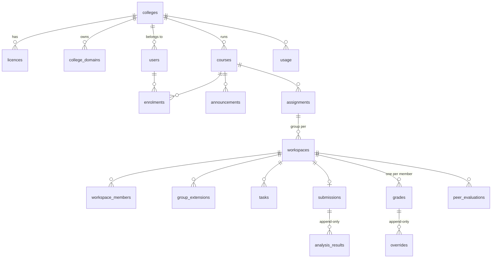

# PostgreSQL schema

Step 1.1 (PEER-21) · Owner: Sonam · Status: agreed contract. The tables are built by node-pg-migrate in step 0.6/1.5 (SO2).

This is the contract for every table in the Peerlytics PostgreSQL database. `backend/openapi.yaml` uses the same names and limits. If a column has to change, change this file in its own PR first, the same way as `docs/auth-contract.md`.

## What lives where

| Store | Holds |
|---|---|
| Firebase Auth | Accounts, sign-in, the `role` and `collegeId` custom claims (`docs/auth-contract.md`) |
| Firestore | Live workspace content: document bodies, Yjs state, presence, activity, notifications, paste events, inline feedback (`groups/{id}/feedback`) |
| PostgreSQL | Everything that has to be relational, audited or reported on: colleges, courses, enrolments, assignments, workspaces, tasks, submissions, analysis results, grades, overrides, peer evaluations, usage and the audit log |

**Privacy rule.** No column stores what a student types while writing. Tracking data is limited to time, counts and paste events (length and class, not the pasted text). The submitted document text stays in Firestore. Only the AI-flagged sentences and the provider's feedback are copied into `analysis_results`, because the lecturer has to see why something was flagged. `docs/privacy-notice.md` (step 4.5) has to describe these columns.

## Conventions

- Primary keys are `uuid` with `DEFAULT gen_random_uuid()`, with two exceptions:
  - `users.id` is the Firebase uid (`text`).
  - `workspaces.id` is the Firestore `groups/{groupId}` id (`text`), so `collab/`, `firestore.rules` and Kezang's existing `/api/groups/:groupId/*` routes keep working without a mapping table.
- All times are `timestamptz`, stored in UTC. API responses send ISO 8601 with an offset.
- `created_at timestamptz NOT NULL DEFAULT now()` on every table. Tables that can be edited also have `updated_at timestamptz NOT NULL DEFAULT now()`, set by the app on every update.
- Scores and grades are `numeric(4,2)` from 0 to 10. Rubric weights are `numeric(3,2)` from 0 to 1.
- Enumerations are `text` with a `CHECK (... IN (...))`, not PostgreSQL enum types, so a migration can add a value without `ALTER TYPE`.
- Foreign keys are indexed. `ON DELETE` is given for each foreign key. Most are `CASCADE` downwards from a course. History tables (analysis results, overrides, usage, audit log) use `RESTRICT` or `SET NULL` so history is never removed by accident.
- Emails are compared in lower case. A unique index on `lower(email)` enforces it, and no `citext` extension is needed.

## Overview

## Tables

### colleges

A college (tenant). Courses, users and usage limits hang off it.

| Column | Type | Null / default | Notes |
|---|---|---|---|
| id | uuid | PK | |
| name | text | NOT NULL | 2–200 chars, e.g. "College of Science and Technology" |
| slug | text | NOT NULL, UNIQUE | `^[a-z0-9-]{2,40}$`, e.g. `cst` |
| created_at | timestamptz | NOT NULL, now() | |
| updated_at | timestamptz | NOT NULL, now() | |

### licences

What a college has paid for, and its monthly AI budget. Read only when the `licensing_enabled` flag is on. When the flag is off there are no limits.

| Column | Type | Null / default | Notes |
|---|---|---|---|
| id | uuid | PK | |
| college_id | uuid | NOT NULL, FK colleges ON DELETE CASCADE | |
| plan | text | NOT NULL | `CHECK (plan IN ('trial','standard'))` |
| seats | integer | NOT NULL | `CHECK (seats > 0)`: the maximum number of student accounts |
| monthly_ai_budget_usd | numeric(10,2) | NOT NULL, 0 | Once `usage.cost_usd` for the calendar month reaches this, analysis falls back to the legacy provider (SO4) |
| starts_on | date | NOT NULL | |
| ends_on | date | NULL | NULL = no end date. `CHECK (ends_on IS NULL OR ends_on > starts_on)` |
| created_at | timestamptz | NOT NULL, now() | |

Index: `(college_id, starts_on DESC)`. The current licence is the latest one whose date range includes today.

### college_domains

Email domains that place a new account in a college (used by step 3.6, Kezang).

| Column | Type | Null / default | Notes |
|---|---|---|---|
| domain | text | PK | Lower case, e.g. `rub.edu.bt`. `CHECK (domain = lower(domain))` |
| college_id | uuid | NOT NULL, FK colleges ON DELETE CASCADE | |
| created_at | timestamptz | NOT NULL, now() | |

### users

One row per Firebase account. It is created the first time the account calls a backend route that needs it (for example joining a course). Firebase custom claims are the source of truth for the role (auth contract §2), and `role` here is a copy kept for joins and reports.

| Column | Type | Null / default | Notes |
|---|---|---|---|
| id | text | PK | The Firebase uid, 1–128 chars |
| college_id | uuid | NULL, FK colleges ON DELETE SET NULL | Same as the `collegeId` claim |
| email | text | NULL | NULL after data deletion. Unique index on `lower(email)` WHERE email IS NOT NULL |
| display_name | text | NOT NULL | 1–100 chars. "Deleted user" after data deletion |
| role | text | NULL | `CHECK (role IN ('superAdmin','collegeAdmin','lecturer','student'))`. NULL = not picked yet |
| deleted_at | timestamptz | NULL | Set by data deletion. The row stays so history keeps its foreign keys |
| created_at | timestamptz | NOT NULL, now() | |
| updated_at | timestamptz | NOT NULL, now() | |

### courses

| Column | Type | Null / default | Notes |
|---|---|---|---|
| id | uuid | PK | |
| college_id | uuid | NULL, FK colleges ON DELETE RESTRICT | NULL until colleges are in use |
| code | text | NOT NULL | 2–20 chars, e.g. `CTE412` |
| title | text | NOT NULL | 2–200 chars |
| description | text | NULL | Up to 5,000 chars |
| term | text | NULL | Up to 40 chars, e.g. "Autumn 2026" |
| join_code | text | NOT NULL, UNIQUE | 8 chars from `ABCDEFGHJKMNPQRSTUVWXYZ23456789` (no 0/O, 1/I/L), made with `crypto.randomInt`. `CHECK (join_code ~ '^[A-HJKMNP-Z2-9]{8}$')` |
| join_code_enabled | boolean | NOT NULL, true | The lecturer can turn joining off |
| owner_id | text | NOT NULL, FK users ON DELETE RESTRICT | The lecturer who created it |
| archived_at | timestamptz | NULL | Archived courses are read-only |
| created_at | timestamptz | NOT NULL, now() | |
| updated_at | timestamptz | NOT NULL, now() | |

Indexes: `(college_id)`, `(owner_id)`.

### enrolments

Who is in a course, and as what. The course owner is enrolled as `lecturer` when the course is created. "Which lecturer teaches which course" comes from here, not from claims (auth contract §8).

| Column | Type | Null / default | Notes |
|---|---|---|---|
| course_id | uuid | PK (with user_id), FK courses ON DELETE CASCADE | |
| user_id | text | PK (with course_id), FK users ON DELETE CASCADE | |
| course_role | text | NOT NULL | `CHECK (course_role IN ('lecturer','student'))` |
| joined_via | text | NOT NULL | `CHECK (joined_via IN ('owner','code','invite'))` |
| joined_at | timestamptz | NOT NULL, now() | |

Index: `(user_id)` for "my courses".

### announcements

The course Overview tab.

| Column | Type | Null / default | Notes |
|---|---|---|---|
| id | uuid | PK | |
| course_id | uuid | NOT NULL, FK courses ON DELETE CASCADE | |
| author_id | text | NOT NULL, FK users ON DELETE RESTRICT | |
| title | text | NOT NULL | 1–200 chars |
| body | text | NOT NULL | 1–10,000 chars of plain text. The frontend renders it as text, never as HTML |
| pinned | boolean | NOT NULL, false | |
| created_at | timestamptz | NOT NULL, now() | |
| updated_at | timestamptz | NOT NULL, now() | |

Index: `(course_id, pinned DESC, created_at DESC)`.

### assignments

| Column | Type | Null / default | Notes |
|---|---|---|---|
| id | uuid | PK | |
| course_id | uuid | NOT NULL, FK courses ON DELETE CASCADE | |
| title | text | NOT NULL | 2–200 chars |
| brief | text | NOT NULL | 1–20,000 chars |
| deadline | timestamptz | NOT NULL | The default deadline for every group. A group's extension overrides it (`group_extensions`) |
| weight_time | numeric(3,2) | NOT NULL, 0.25 | 0–1 |
| weight_edits | numeric(3,2) | NOT NULL, 0.25 | 0–1 |
| weight_writing | numeric(3,2) | NOT NULL, 0.25 | 0–1 |
| weight_tasks | numeric(3,2) | NOT NULL, 0.25 | 0–1 |
| time_cap_minutes | integer | NULL | Writing time that earns a full Time score. NULL = the grading default (SO5). `CHECK (time_cap_minutes > 0)` |
| group_size | integer | NULL | Target size for auto groups. `CHECK (group_size BETWEEN 1 AND 20)` |
| created_by | text | NOT NULL, FK users ON DELETE RESTRICT | |
| created_at | timestamptz | NOT NULL, now() | |
| updated_at | timestamptz | NOT NULL, now() | |

Check: `CHECK (weight_time + weight_edits + weight_writing + weight_tasks = 1.00)`. Each weight is a multiple of 0.01, so the sum is exact. Index: `(course_id, deadline)`.

### workspaces

A group's workspace for one assignment (workspace = project = group). The id is the Firestore `groups/{id}`. The backend creates the Firestore document and this row together.

| Column | Type | Null / default | Notes |
|---|---|---|---|
| id | text | PK | `^[A-Za-z0-9_-]{1,128}$`, the same as the Firestore group id |
| assignment_id | uuid | NOT NULL, FK assignments ON DELETE CASCADE | |
| name | text | NOT NULL | 1–100 chars. UNIQUE `(assignment_id, name)` |
| created_via | text | NOT NULL | `CHECK (created_via IN ('manual','auto'))` |
| status | text | NOT NULL, 'open' | `CHECK (status IN ('open','submitted','locked'))`. `locked` = submitted by the deadline job (step 1.6) |
| created_by | text | NOT NULL, FK users ON DELETE RESTRICT | |
| created_at | timestamptz | NOT NULL, now() | |
| updated_at | timestamptz | NOT NULL, now() | |

Also UNIQUE `(id, assignment_id)`, so `workspace_members` can point at both columns. Index: `(assignment_id)`.

### workspace_members

| Column | Type | Null / default | Notes |
|---|---|---|---|
| workspace_id | text | PK (with user_id) | |
| user_id | text | PK (with workspace_id), FK users ON DELETE CASCADE | |
| assignment_id | uuid | NOT NULL | Copied from the workspace so the unique constraint below can use it |
| joined_at | timestamptz | NOT NULL, now() | |

Foreign key: `(workspace_id, assignment_id)` → `workspaces (id, assignment_id)` ON DELETE CASCADE. Constraint: UNIQUE `(assignment_id, user_id)`, so a student is in at most one group per assignment. Auto groups (SO8) rely on this. The member must be enrolled in the course as a student; the API checks this.

### group_extensions

A new deadline for one group (step 4.6, Kezang). Rows are only added, never changed, and the latest row wins. Until this table is used, Kezang's route keeps `extendedDeadline` on the Firestore group.

| Column | Type | Null / default | Notes |
|---|---|---|---|
| id | uuid | PK | |
| workspace_id | text | NOT NULL, FK workspaces ON DELETE CASCADE | |
| deadline | timestamptz | NOT NULL | The new deadline |
| previous_deadline | timestamptz | NULL | The deadline in force before this extension |
| reason | text | NOT NULL | 5–500 chars, the same limit as `extensionBody` in `backend/src/jobs/deadlines/extensions.js` |
| granted_by | text | NOT NULL, FK users ON DELETE RESTRICT | |
| created_at | timestamptz | NOT NULL, now() | |

Index: `(workspace_id, created_at DESC)`. Effective deadline = the latest `group_extensions.deadline` for the workspace, otherwise `assignments.deadline`.

### tasks

The group's task list (SO5). Members can change tasks only while the workspace is `open`.

| Column | Type | Null / default | Notes |
|---|---|---|---|
| id | uuid | PK | |
| workspace_id | text | NOT NULL, FK workspaces ON DELETE CASCADE | |
| title | text | NOT NULL | 1–200 chars |
| owner_id | text | NULL, FK users ON DELETE SET NULL | Must be a member of the workspace (checked by the API) |
| tab_id | text | NULL | The linked document tab: the Yjs fragment id from `src/collab/tabs.js`, 1–64 chars |
| due_at | timestamptz | NULL | |
| done_at | timestamptz | NULL | Set when ticked, cleared when unticked |
| done_by | text | NULL, FK users ON DELETE SET NULL | |
| created_by | text | NOT NULL, FK users ON DELETE RESTRICT | |
| created_at | timestamptz | NOT NULL, now() | |
| updated_at | timestamptz | NOT NULL, now() | |

Check: `CHECK ((done_at IS NULL) = (done_by IS NULL))`. Index: `(workspace_id)`, `(owner_id)`.
For the Tasks score, a task counts as done for its owner when `done_at <= effective deadline` and the owner made real edits in `tab_id` (from the submission's author metrics).

### submissions

One per workspace. Created by a member's submit or by the deadline job. From this point the workspace's inputs are locked, and the lecturer can see the workspace.

| Column | Type | Null / default | Notes |
|---|---|---|---|
| id | uuid | PK | |
| workspace_id | text | NOT NULL, UNIQUE, FK workspaces ON DELETE CASCADE | |
| submitted_by | text | NULL, FK users ON DELETE SET NULL | NULL when the deadline job submitted |
| trigger | text | NOT NULL | `CHECK (trigger IN ('manual','deadline'))` |
| word_count | integer | NOT NULL | `CHECK (word_count >= 0)` |
| tabs | jsonb | NULL | `[{ id, title, depth, wordCount }]`, the shape of `backend/src/tabs/reportTabs.js` |
| author_metrics | jsonb | NOT NULL | Per student, snapshotted at submission: `{ "<uid>": { timeSpentSec, edits, pasteEvents, largePastes, tabEdits: { "<tabId>": n } } }`. Validated with Ajv. Counts only, never text |
| document_ref | text | NOT NULL | The Firestore path of the submitted body, e.g. `groups/{id}/files/{fileId}` |
| submitted_at | timestamptz | NOT NULL, now() | |

### analysis_results

**Append-only.** The provider's result for a submission. A trigger (`analysis_results_immutable`, built in SO2) runs `BEFORE UPDATE OR DELETE ... FOR EACH ROW` and raises an exception, so a result can't be changed or removed, even by the app's own database user. A re-run inserts a new row, and the latest row is the current one.

| Column | Type | Null / default | Notes |
|---|---|---|---|
| id | uuid | PK | |
| submission_id | uuid | NOT NULL, FK submissions ON DELETE RESTRICT | |
| provider | text | NOT NULL | `CHECK (provider IN ('openai','legacy'))`. `legacy` = Hugging Face + Virtual Writing Tutor |
| model | text | NULL | e.g. the OpenAI model name. NULL for legacy |
| status | text | NOT NULL | `CHECK (status IN ('completed','partial','unavailable'))`. `unavailable` keeps the "submission never fails" rule: the row records why |
| fallback_reason | text | NULL | Why the main provider wasn't used: `openai_error`, `openai_timeout`, `openai_invalid_output` (the reply failed the schema), `openai_not_configured` (no key or model), `budget_reached` (also when licensing is on and the college has no current licence), `flag_legacy` (the `ai_provider` flag or a lecturer's re-run chose legacy). The last two values were added by migration `1792368000002` |
| ai_likelihood | smallint | NULL | 0–100. A signal, not proof |
| flagged_sentences | jsonb | NOT NULL, '[]' | `[{ sentence, reason, authorId? }]`, up to 50 |
| writing_quality | numeric(4,2) | NULL | 0–10 |
| writing_feedback | jsonb | NOT NULL, '{}' | `{ strengths[], weaknesses[], summary }` |
| difficulty | smallint | NULL | 1 (easy) – 3 (hard), the same scale as `utils/difficultyDetection.js` |
| grade_explanation | text | NULL | The provider's plain-English explanation, up to 4,000 chars |
| result | jsonb | NOT NULL | The full validated payload (`schemas/analysis-result.json`, SO4) |
| schema_version | smallint | NOT NULL, 1 | |
| created_at | timestamptz | NOT NULL, now() | |

Checks: `ai_likelihood BETWEEN 0 AND 100`, `writing_quality BETWEEN 0 AND 10`, `difficulty BETWEEN 1 AND 3`. Index: `(submission_id, created_at DESC)`.

### grades

The suggested grade for each student in a workspace, worked out on the server by `backend/grading/` (SO5). It is recomputed (replaced) when a new analysis result arrives. The lecturer's decision is never stored here: it goes in `overrides`.

| Column | Type | Null / default | Notes |
|---|---|---|---|
| id | uuid | PK | |
| workspace_id | text | NOT NULL, FK workspaces ON DELETE CASCADE | |
| user_id | text | NOT NULL, FK users ON DELETE CASCADE | UNIQUE `(workspace_id, user_id)` |
| analysis_result_id | uuid | NULL, FK analysis_results ON DELETE RESTRICT | The analysis it was computed from. NULL if analysis was unavailable |
| time_score | numeric(4,2) | NOT NULL | 0–10 |
| edits_score | numeric(4,2) | NOT NULL | 0–10 |
| writing_score | numeric(4,2) | NULL | 0–10. NULL when no analysis was available; its weight is then shared among the other scores (migration `1792368000003`) |
| tasks_score | numeric(4,2) | NULL | 0–10. NULL when the group made no tasks; same rule |
| weights | jsonb | NOT NULL | The assignment's `{ time, edits, writing, tasks }` when it was computed, so later rubric edits don't silently change a grade |
| deductions | jsonb | NOT NULL, '[]' | `[{ kind: 'ai'|'paste', points, reason }]`. Applies only to this student |
| suggested | numeric(4,2) | NOT NULL | Weighted sum minus deductions, clamped to 0–10. Worked out by `backend/grading/` |
| explanation | text | NOT NULL | "Why this grade" in plain English |
| computed_at | timestamptz | NOT NULL, now() | |

The final grade is the latest `overrides.new_grade` for the grade, otherwise `suggested`.

### overrides

**Append-only.** A lecturer's change to a grade: who, when and why. The app only inserts rows. SO2 adds the same immutability trigger as `analysis_results`.

| Column | Type | Null / default | Notes |
|---|---|---|---|
| id | uuid | PK | |
| grade_id | uuid | NOT NULL, FK grades ON DELETE RESTRICT | A grade with overrides can't be deleted, so a recompute updates the grade row in place |
| lecturer_id | text | NOT NULL, FK users ON DELETE RESTRICT | Who |
| previous_grade | numeric(4,2) | NOT NULL | The final grade before this change |
| new_grade | numeric(4,2) | NOT NULL | 0–10 |
| reason | text | NOT NULL | Why: 5–1,000 chars |
| created_at | timestamptz | NOT NULL, now() | When |

Index: `(grade_id, created_at DESC)`.

### peer_evaluations

Behind `peer_eval_enabled` (SO8). Only after submission. Not part of the grade.

| Column | Type | Null / default | Notes |
|---|---|---|---|
| id | uuid | PK | |
| workspace_id | text | NOT NULL, FK workspaces ON DELETE CASCADE | |
| rater_id | text | NOT NULL, FK users ON DELETE CASCADE | |
| ratee_id | text | NOT NULL, FK users ON DELETE CASCADE | |
| rating | smallint | NOT NULL | `CHECK (rating BETWEEN 1 AND 5)` |
| comment | text | NULL | Up to 500 chars. Lecturers see it; the rated student does not |
| created_at | timestamptz | NOT NULL, now() | |
| updated_at | timestamptz | NOT NULL, now() | |

Constraints: UNIQUE `(workspace_id, rater_id, ratee_id)`, `CHECK (rater_id <> ratee_id)`.

### usage

One row per paid external call (SO4 writes it; step 3.10 reports it). This is how the monthly budget in `licences` is checked.

| Column | Type | Null / default | Notes |
|---|---|---|---|
| id | bigint | PK, generated always as identity | |
| college_id | uuid | NULL, FK colleges ON DELETE SET NULL | |
| course_id | uuid | NULL, FK courses ON DELETE SET NULL | |
| submission_id | uuid | NULL, FK submissions ON DELETE SET NULL | |
| provider | text | NOT NULL | `CHECK (provider IN ('openai','huggingface','vwt'))` |
| model | text | NULL | |
| outcome | text | NOT NULL | `CHECK (outcome IN ('ok','error','timeout','invalid_output'))` |
| prompt_tokens | integer | NOT NULL, 0 | |
| completion_tokens | integer | NOT NULL, 0 | |
| cost_usd | numeric(10,6) | NOT NULL, 0 | An estimate, from the price table in config |
| latency_ms | integer | NULL | |
| created_at | timestamptz | NOT NULL, now() | |

Index: `(college_id, created_at)` for "this month's spend".

### audit_log

**Append-only.** Who did what. Role changes (auth contract §5), extensions, overrides, auto groups, join-code changes and data deletions are written here. It holds ids and changed fields, never document text.

| Column | Type | Null / default | Notes |
|---|---|---|---|
| id | bigint | PK, generated always as identity | |
| actor_id | text | NULL, FK users ON DELETE SET NULL | NULL = the system (deadline job, migrations) |
| action | text | NOT NULL | Dotted name, e.g. `role.changed`, `deadline.extended`, `grade.overridden`, `groups.auto_created`, `course.join_code_reset`, `user.data_deleted` |
| target_type | text | NOT NULL | e.g. `user`, `workspace`, `grade`, `course` |
| target_id | text | NOT NULL | |
| details | jsonb | NOT NULL, '{}' | e.g. `{ "from": "student", "to": "lecturer" }` |
| created_at | timestamptz | NOT NULL, now() | |

Index: `(target_type, target_id, created_at DESC)`, `(actor_id, created_at DESC)`.

## Data deletion

`DELETE /api/me/data` and `DELETE /api/admin/users/{uid}/data` (step 4.9, Tshewang) cannot remove `analysis_results` rows (trigger) or `overrides` and `audit_log` rows, because they are history. Instead:

- `users`: `email` → NULL, `display_name` → "Deleted user", `deleted_at` → now(). The Firebase account is deleted.
- Rows are deleted from `enrolments`, `workspace_members`, `peer_evaluations` (given and received) and `tasks.owner_id` / `done_by` (set to NULL).
- The `author_metrics` key for the user in `submissions` is replaced by a random id.
- `analysis_results.flagged_sentences[].authorId` still holds the uid, but nothing links that uid to a person any more.
- One `audit_log` row: `user.data_deleted`.

## Routes that use each table

| Table | Main routes in `backend/openapi.yaml` |
|---|---|
| colleges, licences, college_domains | Read by the usage, licensing and sign-up checks; no public CRUD in this contract |
| users | `/auth/*`, `/me/data`, `/admin/users/{uid}/*` |
| courses, enrolments | `/courses`, `/courses/join`, `/courses/{courseId}`, `/courses/{courseId}/join-code`, `/courses/{courseId}/members` |
| announcements | `/courses/{courseId}/announcements`, `/announcements/{announcementId}` |
| assignments | `/courses/{courseId}/assignments`, `/assignments/{assignmentId}` |
| workspaces, workspace_members | `/assignments/{assignmentId}/groups`, `/assignments/{assignmentId}/groups/auto`, `/workspaces/{workspaceId}`, `/me/workspaces` |
| group_extensions | `/groups/{groupId}/extension` |
| tasks | `/workspaces/{workspaceId}/tasks`, `/tasks/{taskId}` |
| submissions | `/workspaces/{workspaceId}/submission`, `/workspaces/{workspaceId}/events` |
| analysis_results | `/submissions/{submissionId}/analysis` |
| grades, overrides | `/courses/{courseId}/grades`, `/courses/{courseId}/grades.csv`, `/workspaces/{workspaceId}/grades`, `/grades/{gradeId}/overrides` |
| everything above | `/workspaces/{workspaceId}/report.xml`, `/courses/{courseId}/comparison` |
| peer_evaluations | `/workspaces/{workspaceId}/peer-evaluations` |
| usage | `/usage` |
| audit_log | Written by many routes; no read route in this contract |
