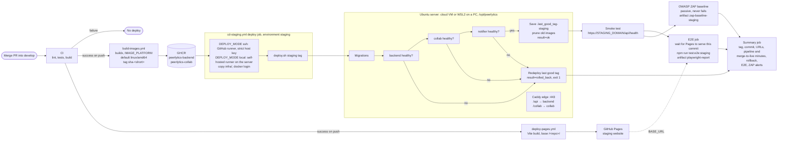

# CD pipeline (report Figure 3.13)

How a change reaches staging, and a version tag reaches production. Details: [../deploy.md](../deploy.md).

Before a merge, **CD checks** (`cd-checks.yml`) runs on the PR: actionlint, shellcheck, the deploy script tests with a fake docker, `docker compose config`, `caddy validate` and arm64 image builds.

## Production (step 5.1)

```mermaid
flowchart LR
  tag([git push origin v1.2.3]) --> verify[verify-ci<br/>gh api: CI succeeded<br/>for this commit?]
  verify -- no --> stop([Fail])
  verify -- yes --> build[build-images.yml<br/>tag v1.2.3]
  build --> approve{{environment production<br/>required reviewer}}
  approve --> deploy[deploy.sh prod v1.2.3]

  subgraph server[Ubuntu server: cloud VM or WSL2 on a PC]
    deploy --> mig[Migrations]
    mig --> idle[New tag on idle colour<br/>e.g. backend_green, jobs off]
    idle -- unhealthy --> rb[Idle colour back on its old tag<br/>live colour untouched<br/>result=rolled_back, exit 1]
    idle -- healthy --> on[Green again with jobs on]
    on --> switch[Caddy upstream to green<br/>caddy reload]
    switch --> off[Blue again with jobs off]
    off --> keep[backend_blue keeps running<br/>rollback.sh prod switches back]
    keep --> rest[collab, then notifier<br/>each healthy]
  end

  rest --> smoke[Smoke test<br/>https://PROD_DOMAIN/api/health]
  smoke --> web[Firebase Hosting live<br/>built with VITE_API_URL_PROD]
  web --> rel[GitHub release<br/>generated notes]
  rel --> psum[Summary job<br/>tag to live, approval wait,<br/>since the merge, rollback, colour]
  rb --> psum
```

